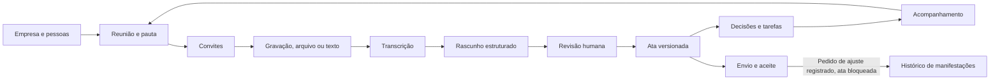

# Produto e arquitetura

## Ciclo e responsabilidades

O pedido explícito de criar/organizar uma reunião é tratado como proposta de preparação, sem executar criação ou convites. O formulário existente é a confirmação de criação; sua validação continua no serviço de reuniões. Referências históricas do chat nunca são inferidas como reunião alvo de uma apresentação.

`components/product/presenter.tsx` lê snapshots de materiais pela rota autenticada existente, após ACL do destino e das fontes. Renderiza texto como React, sem HTML da IA, permite navegação por slide e tela cheia e mantém a mesma instância do gravador. A troca de etapa e entradas alternativas são bloqueadas enquanto houver captura ou áudio local ainda não enviado. Slides não são usados como evidência de decisões na ata.

## Gravação em partes e conhecimento

As migrações aditivas 0004–0006 criam `recordings`, `recording_parts`, `knowledge_documents`, perfis de participantes e convites de acesso, além dos índices correspondentes. Nenhuma migração anterior foi alterada. A sessão reserva o único registro `files` da reunião (`audio/segments`), encerrando a preparação ao iniciar explicitamente. Partes independentes de MediaRecorder são armazenadas em R2 com sequência única e hash do conteúdo; repetir o upload não substitui bytes já confirmados. O encerramento exige sequência contígua de 0 até `partCount-1`, bloqueia novos trechos e habilita o processamento. Cada parte tem checkpoint de transcrição; Inngest usa passos separados por parte, e o texto é consolidado por sequência para gerar uma ata. Arquivos antigos e o upload unitário continuam compatíveis.

O navegador reinicia o contêiner de áudio a cada aproximadamente cinco minutos, mantendo o mesmo stream do microfone. Esta técnica pode introduzir uma pequena lacuna de transição, que deve ser medida com áudio real. Partes enviadas são liberadas da memória. Falhas preservam as pendentes para repetição/download; a captura pausa ao acumular mais de 32 MB pendentes. Fechar a página perde a parte em curso e bytes pendentes, mas os trechos já recebidos podem ser consultados e finalizados. Não existe retomada automática de captura após recarregar. Cada parte tem limite de 20 MB e a sessão aceita até 1.000 partes.

Conhecimento é gerenciado por administradores e compartilhado com toda a organização somente após revisão explícita. Rascunhos e documentos arquivados são visíveis apenas aos administradores. PDF com texto é extraído com unpdf no Worker; TXT/Markdown usam UTF-8, sem executar HTML/scripts. O original fica em R2 privado. A recuperação lexical seleciona até seis documentos revisados, com até 4.000 caracteres por fonte, identificando revisão e origem importada. Chat, propostas e materiais revalidam revisões/estado das fontes. O contexto do processamento recebe referências relevantes, mas documentos históricos não servem como evidência de novas decisões ou tarefas: isso continua exigindo texto da reunião atual. Não há vetores, OCR, reconhecimento de pessoas pela voz nem troca de provedor nesta entrega.

O banco é a fonte de verdade. Preferências locais não armazenam a memória empresarial. As gravações ficam transitoriamente no navegador antes do upload; os bytes enviados ficam no R2 e seus metadados no D1.

## Módulos

- `lib/server/security.ts` e `auth.ts`: links de login, sessões, rate limiting, autorização por organização/reunião e proteção de origem.
- `lib/server/meetings.ts`: organizações, participantes, preparação, revisão, finalização transacional e acompanhamento.
- `lib/server/jobs.ts`: orquestração durável Inngest, checkpoints persistidos, resultados candidatos e recuperação.
- `lib/server/providers.ts`: transcrição, geração estruturada e e-mail; proteção dos corpos de e-mail pendentes com AES-GCM.
- `lib/server/communication.ts`: convite, compartilhamento de versões, aceite individual, renovação e histórico.
- `lib/server/memory.ts`: recuperação relacional autorizada, filtros internos, contexto de continuidade, intenções do chat e conversas privadas persistidas.
- `lib/server/memory-provider.ts`: consulta de IA com síntese fundamentada, validação de origem e citações literais.
- `lib/domain/memory.ts`: contratos de fontes, respostas, citações e compatibilidade com turnos antigos.
- `lib/domain/chat.ts`: classificação de perguntas, inferência de escopo e identificação de pedidos de pauta/apresentação.
- `lib/server/api.ts`: fronteira HTTP com validação, erros previsíveis e respostas sem cache.
- `lib/domain/model.ts`: contratos Zod e regras puras do domínio.
- `components/product`: superfícies de trabalho, formulário de reunião, gravação, editor, impressão e aceite.

## Entidades

`users` representa a identidade global por e-mail. `memberships` define a relação do usuário com cada `organization`. `participants` representa contatos dentro da organização; a identidade externa não recebe acesso interno automaticamente. Um participante interno recebe o vínculo ao entrar com o e-mail cadastrado. A atualização de sua função sincroniza o vínculo existente.

`meetings` mantém preparação e rascunho mutável, com `revision` para concorrência. A pauta ordenada é JSON validado, com identificadores estáveis e referência opcional à tarefa de origem. `meeting_participants` mantém presença, confirmada manualmente.

`files`, `transcripts` e `jobs` preservam o conteúdo e as etapas de processamento. O resultado da IA é sempre um candidato separado. A incorporação exige ação explícita; uma versão finalizada nunca é substituída pelo processamento.

`minutes` armazena snapshots imutáveis: conteúdo da ata, dados da reunião, organização e participantes no instante da finalização. `decisions` e `tasks` são registros operacionais confirmados, vinculados à sua versão de origem. Uma revisão atualiza a descrição da tarefa com o mesmo ID e preserva o status. Itens removidos ficam inativos; a versão anterior continua preservando o texto original.

`acceptances` vincula destinatário, hash do token, prazo, versão e manifestação. `deliveries` registra deduplicação, estado e identificador do provedor. O corpo fica criptografado enquanto aguarda envio e é descartado após a confirmação do Resend. Em teste local, permanece marcado e disponível somente para o organizador/administrador.

`events` registra as ações da reunião. `auth_tokens`, `sessions` e `rate_limits` sustentam autenticação e proteção contra abuso.

## Isolamento e autorização

- Todo acesso empresarial resolve primeiro a sessão e um vínculo com a organização solicitada. O ID vindo do cliente é apenas um seletor, nunca autorização.
- Administradores gerenciam as reuniões da organização. Membros consultam reuniões em que são organizadores ou participantes.
- Organizador/administrador editam preparação e ata. O responsável interno também pode atualizar a situação de sua tarefa.
- Participantes externos acessam apenas o snapshot de ata concedido pelo token; não recebem lista de reuniões, tarefas empresariais, transcrições ou arquivos.
- IDs de participantes, arquivos e pendências são validados contra a organização e a reunião de origem.
- Links de login expiram em 15 minutos, são consumidos atomicamente por POST e não são consumidos por leitores automáticos de e-mail. Sessões expiram em sete dias, são revogáveis e usam cookie HttpOnly, SameSite=Lax e Secure em produção.
- Aceites expiram em sete dias. Abrir o link apenas lê. Manifestar-se exige POST. Renovar substitui o hash e invalida o link anterior. Versões superadas continuam consultáveis pelo link válido, mas não aceitam novas manifestações.

## Consistência

Salvar rascunhos e preparação exige a revisão esperada. Finalizar usa um lote transacional D1: uma marca única vincula a atualização do estado, a inserção da versão e as atualizações das tarefas/decisões. Uma segunda finalização concorrente não insere registros.

Tarefas mantêm progresso ao longo das revisões e podem ser acompanhadas antes do aceite. Novas revisões só são permitidas antes do primeiro envio para aceite. Depois de enviada, a ata não pode ser reaberta, inclusive quando há solicitações de ajuste. Quando todos os destinatários aceitam, novos envios ficam bloqueados.

O processamento usa chave idempotente por reunião e request. Etapas retomam a transcrição persistida e um resultado existente. Envios usam caixa de saída persistente e chave idempotente do Resend. A janela de nova tentativa é limitada a 23 horas para permanecer dentro da janela do provedor; depois disso, renovar o link cria um envio novo e explícito.

## IA

O contexto contém objetivo, pauta, negócio, data/fuso e participantes da reunião. A transcrição é dado não confiável, nunca instrução executável. Não são disponibilizadas ferramentas de execução ou envio ao modelo.

Structured Outputs retorna um contrato validado pelo servidor. Responsáveis desconhecidos são anulados; evidências que não aparecem literalmente na transcrição são removidas e geram ponto de conferência. Datas ausentes ficam nulas. A revisão humana continua obrigatória, inclusive quando o formato é válido.

## Memória institucional (Etapa 1)

A recuperação usa SQL parametrizado no D1, sem infraestrutura vetorial. A CTE `allowed` restringe organização e reuniões visíveis (administrador, organizador ou participante) antes da seleção, pontuação e limite. A busca consulta a versão finalizada mais recente, decisões/tarefas ativas dessa versão e, somente com inclusão explícita, o rascunho em revisão. Versões anteriores continuam disponíveis no histórico e na impressão; não disputam posição com o registro corrente na busca. Áudios, transcrições brutas, corpos de e-mail, links individuais de aceite e dados de organizações alheias não são contexto do chat.

O conteúdo distingue revisão humana confirmada ainda não enviada, aceite pendente, aceite de todos, pedido de ajuste com ata bloqueada e rascunho não confirmado. O negócio cadastrado da organização pode ser fonte em perguntas pertinentes sobre a empresa, sem filtros específicos de reunião. Nomes e situação atual das tarefas vêm dos registros operacionais, preservando seus IDs.

O chat não expõe filtros. A camada de intenção infere assunto, intervalo, responsável e situação quando esses dados aparecem na pergunta; os mesmos filtros continuam existindo internamente para limitar a recuperação. “Vencidas” usa o dia atual no fuso da organização. A intenção de última reunião resolve a data mais recente entre atas finalizadas autorizadas no assunto/período; empates são sinalizados. Pendências são tarefas ativas em aberto ou em andamento. Perguntas com assunto nomeado usam correspondência lexical normalizada de acentos e termos, classificação por correspondência, confirmação e recência. A busca não oferece compreensão semântica irrestrita ou cobertura exaustiva de todo o acervo.

Até 24 fontes de reunião e 36 mil caracteres de corpo compõem o contexto, com teto de 6 mil por fonte; pode ser acrescentada uma fonte de empresa de até 4 mil caracteres. Truncamento é sinalizado, orientando refinar a pergunta. A IA recebe apenas esses dados, sem ferramentas e sem permissão para executar ações. O contrato contém resultado (`evidence`, `ambiguous`, `insufficient`), síntese curta e citações literais com identificadores. O servidor rejeita IDs ausentes e texto que não seja substring literal da fonte. Links, nomes, datas, tipos e situação são montados pelo servidor. Respostas novas podem conter uma síntese fundamentada; cada fato precisa apontar para uma citação literal de fonte autorizada. Turnos antigos continuam compatíveis com respostas somente extrativas. Isso verifica rastreabilidade, mas não prova completude, relevância ou a verdade do conteúdo registrado.

`memory_chats` pertence a um usuário em uma organização. `memory_turns` preserva pergunta, filtros, resposta, dependências de reuniões, estado e horários. Até administradores só acessam suas próprias conversas. Leituras revalidam o conjunto de dependências de cada resposta; se qualquer reunião deixar de ser visível, pergunta, filtros e resposta desse turno ficam ocultos. Títulos de conversa são genéricos, sem fatos derivados. A autorização é resolvida novamente após a resposta do provedor e antes da gravação. Respostas antigas são snapshots identificados pela data; andamento e aceite atuais são consultados pelos links.

Perguntas de continuidade sem assunto explícito podem reutilizar o escopo da última resposta ainda autorizada e termos da pergunta anterior. Os registros são recuperados novamente; texto produzido anteriormente pela IA nunca vira fonte factual. Listagem de conversas e mensagens usa páginas de 100, com cursor `before` autorizado e ordenação por data/ID. Os registros anteriores permanecem persistidos e acessíveis pela paginação.

Cada envio tem um `requestId` único. Repetições concluídas retornam o histórico; falhas retomam o mesmo turno; solicitações concorrentes são bloqueadas por gravação condicional. Uma solicitação interrompida pode ser retomada depois de dois minutos; o resultado anterior não sobrepõe a nova tentativa. O provedor tem timeout de 45 segundos. Há limite de 30 perguntas por usuário/organização por hora e 100 novas conversas por usuário por hora. Ausência de evidência não exige chamada de IA. O modo local copia trechos identificados como teste, sem chamadas externas.

As migrações `0001`–`0003` permanecem intactas. As migrações aditivas `0004` e `0005` acrescentam somente o armazenamento de gravações em partes, o conhecimento da empresa e seus índices; nenhuma tabela ou configuração anterior é substituída. As regras de gravação, processamento, revisão, envio, aceite e tarefas continuam aplicadas pelos mesmos serviços.

## Entregas desta continuação

2. Preparação com IA: sugestões de assuntos e pauta, seleção/edição explícita e vínculos de origem, incluindo propostas solicitadas no chat.
3. Materiais de apoio e slides: gerar a partir da pauta revisada, visualizar, baixar e persistir com a reunião.

Cobrança, calendários, reconhecimento de voz e assinatura certificada estão fora desta continuação. Pedidos de ajuste continuam registrados sem reabrir a ata enviada; nenhum fluxo de retificação foi introduzido.

## Preparação com histórico (Etapa 2)

`memory-retrieval.ts` concentra a recuperação autorizada reutilizada pelo chat e pela preparação. `planning.ts` persiste propostas privadas em `agenda_proposals` (migração incremental 0002). Propostas têm objetivo, assunto, itens, fontes e estado de geração separados da reunião. A IA seleciona fontes relevantes e cita trechos literais; títulos factuais derivam dos registros, sem criação livre de responsáveis, datas ou decisões. Há itens de objetivo, contexto, pendências, tarefas vencidas e temas presentes em mais de uma reunião entre as fontes selecionadas. Recorrência é observada nessa seleção, não inferida como estatística exaustiva do acervo.

Geração exige acesso de edição à reunião alvo e preparação aberta, com nova verificação após a resposta do provedor. Sem histórico relevante, há somente um ponto de partida pelo objetivo, identificado sem alegar IA. O modo local também é explicitamente identificado. Falhas retomam o mesmo requestId; cada usuário/organização pode solicitar até 20 propostas por hora.

`agenda[].origin` é opcional para preservar pautas existentes. Guarda proposalId/itemId; taskId permanece vinculado à tarefa original. Salvar valida autor/retomada de origem existente, organização, reunião alvo, item, identidade da tarefa e autorização das fontes. Editar títulos não muda os vínculos. Participantes só recebem detalhes de origem quando podem consultar todas as fontes do item. Propostas são privadas por autor; incorporá-las é uma ação humana explícita. Nenhuma proposta altera atas, progresso de tarefas, presença, aceites ou a regra de bloqueio da preparação.

O chat reconhece pedidos naturais de pauta, inclusive perguntas sobre assuntos para a próxima reunião, e retorna uma proposta persistida. Pedidos de apresentação retornam uma ação explícita: quando existe uma reunião editável, a pessoa é encaminhada à preparação; quando não existe, a proposta precisa ser salva primeiro. A navegação para o formulário carrega a proposta, mas não cria reunião, escolhe data ou participantes nem incorpora itens automaticamente.

## Materiais de apoio (Etapa 3)

`materials.ts` gera apresentações HTML independentes a partir da pauta salva, mediante `agendaReviewed: true` e revisão esperada. `lib/domain/materials.ts` organiza objetivo, agenda, contexto, pendências e perguntas para discussão em páginas com fontes. A geração é determinística, sem alegação de IA: textos factuais vêm dos registros, enquanto perguntas são claramente propostas. HTML escapa conteúdo, não executa scripts e não carrega recursos externos. O visual usa a identidade da aplicação. Não há exportação PPTX; PDF usa impressão do navegador.

O contexto reaproveita origens de sugestões selecionadas e tarefas vinculadas manualmente. Essas tarefas são lidas novamente com a ACL, preservando a situação operacional. Sem origens vinculadas, uma busca lexical autorizada acrescenta até seis fontes pertinentes ao assunto/objetivo, excluindo a reunião alvo. O contexto é uma seleção, não um resumo exaustivo do acervo. Registros incluídos são snapshots identificados por sua origem e data; não substituem os registros atuais.

`meeting_materials` (migração incremental 0003) guarda organização, reunião, autor, revisão, chave privada R2, snapshot estruturado, dependências e data. O HTML fica no R2 privado. Gerar não modifica a pauta ou ata, inclusive em reuniões já processadas. A revisão é conferida antes de gerar e em INSERT condicional depois do armazenamento; conflitos removem somente o arquivo recém-gerado. Repetições de requestId reutilizam o material existente. Os materiais anteriores permanecem armazenados; a listagem retorna os 100 mais recentes autorizados.

Leitura, snapshot JSON, preview e download conferem acesso à reunião alvo e a TODAS as reuniões fonte. Um participante do destino sem acesso ao contexto não recebe o material. Alterações posteriores de acesso bloqueiam o download. A resposta usa no-store, nosniff e CSP restritiva; o preview usa iframe com sandbox. O material só contém links internos gerados no servidor, além dos textos revisados e suas fontes. Arquivos baixados ficam sob o controle de quem os baixou, como qualquer exportação.

As três etapas prioritárias estão implementadas. O aceite simples e os bloqueios existentes permanecem intactos. Cobrança, calendário, reconhecimento de voz e assinatura certificada continuam fora do escopo.

## Conta empresarial e perfis dos participantes (10/09/2026)

A migração aditiva 0006 acrescenta `auth_tokens.participant_id` e `participants.department`, `responsibilities`, `revision`, com defaults constantes e sem alterar migrações anteriores. Não há tabela de assinatura, cronômetro de teste ou bloqueio comercial nesta etapa; o usuário decidiu delegar esses controles ao futuro meio de pagamento.

O administrador cadastra a empresa e os participantes. O cadastro de um interno autoriza o vínculo pelo e-mail verificado; usuários existentes recebem membership e novos usuários o recebem ao confirmar o e-mail. O convite de acesso é um envio explícito separado do convite para a reunião. Usa token de sete dias, hash no D1, corpo protegido na caixa de saída e transporte Resend existente. Verificação de convite exige que o participante ainda seja interno. Demover para externo revoga o vínculo e os tokens vinculados em uma transação. O login retorna a empresa alvo do convite. Um externo nunca recebe membership por ter sido selecionado para uma reunião ou por criar uma conta independente.

Perfis são selecionados por organização e relevância lexical para chat e preparação; quando há reunião alvo, sugestões usam somente os perfis das pessoas selecionadas. Na geração da ata, `processingParticipants` aplica ACL de edição da reunião e consulta apenas seus participantes e sua organização. Nomes e setores também compõem o contexto de vocabulário da transcrição. Perfis são dados, não instruções, atribuições de tarefas ou evidência de quem falou. Referências de perfil carregam revisão e são revalidadas pelo mesmo fluxo de dependências do conhecimento.

O cadastro de contexto do negócio foi removido da interface. O texto legado permanece armazenado e consultável no Conhecimento da empresa; documentos antigos de equipe permanecem legíveis. Novas responsabilidades são informadas no cadastro da pessoa.
